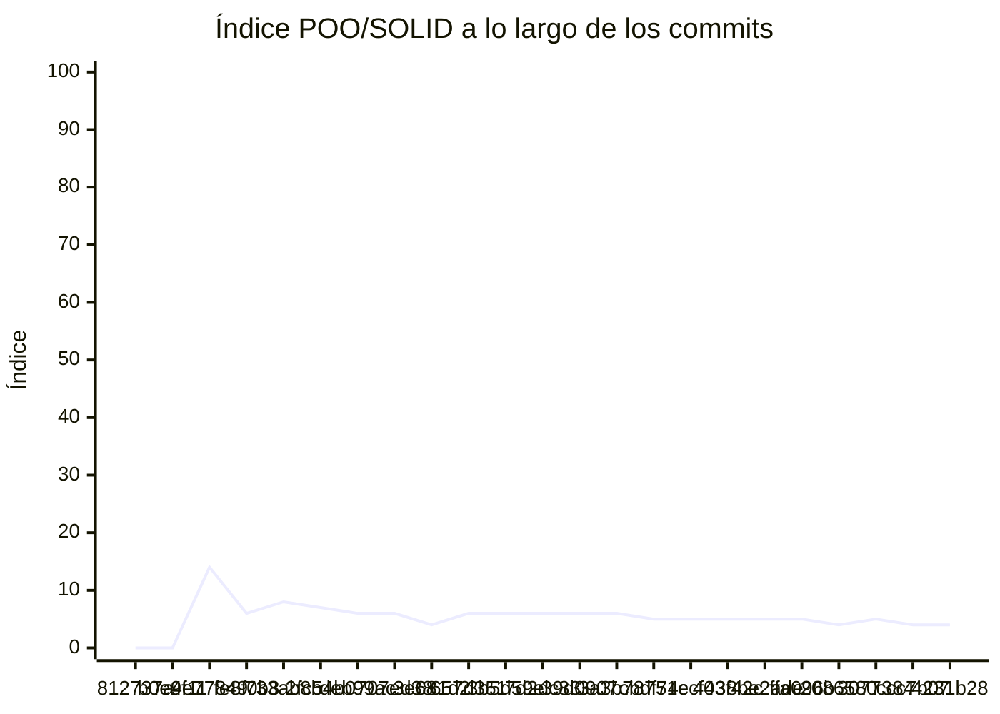

<!-- evaluacion:inicio -->
# Evaluación — proyecto-fisica-chiaramonte/2026-Proyecto-programacion-tiro-oblicuo

> Documento **generado automáticamente** por la cátedra de Programación II (RepoSense + análisis de calidad POO/SOLID). **No editar a mano**: se regenera en cada evaluación.
> Rama evaluada: `main`. Análisis **heurístico** (regex + métricas): es una criba para orientar la revisión, **no una nota**.
> Generado: 2026-10-29.

## 1. Veredicto

| Aspecto | Resultado |
|---|---|
| Índice de calidad POO/SOLID | **4/100** |
| Código (LOC) | 1,998 |
| Archivos de código | 24 |
| Clases (bien usadas) | 22 (3 OK) |
| Código dentro de clases (%POO) | 81% |
| Funciones fuera de clases | 0 |
| Duplicación lógica | 22.4% |
| Señales S/O/L/I/D | 6/0/1/0/14 |
| Tope duro aplicado | `DUP>=15%` → índice ≤ 50 |

> Este informe **describe** lo que el análisis midió con los criterios ya establecidos de la materia. No es una nota.

### Semáforo de aprobación

Criterios de `CRITERIOS-CALIDAD.md`. **Aprobar** se juega con el perfil `estandar`; **destacar**, con el `exigente` (meta de excelencia).

| Semáforo | Resultado |
|---|---|
| Aprobar (`estandar`) | **no cumple** — 1/4 |
| Destacar (`exigente`) | **no cumple** — 1/5 |

**Criterios para aprobar**

| Criterio | Requisito | Tu resultado | Cumple |
|---|---|---|---|
| Código dentro de clases (%POO) | ≥ 85% | 81% | no |
| Duplicación lógica | ≤ 10% | 22.4% | no |
| Funciones fuera de clases | ≤ 1 | 0 | sí |
| Señales POO/SOLID críticas | ninguna | Clase demasiado grande (SRP), Acoplamiento alto (CBO), Override vacío / 'no implementado' (LSP) | no |

**Criterios para destacar**

| Criterio | Requisito | Tu resultado | Cumple |
|---|---|---|---|
| Código dentro de clases (%POO) | ≥ 95% | 81% | no |
| Duplicación lógica | ≤ 5% | 22.4% | no |
| Funciones fuera de clases | ≤ 1 | 0 | sí |
| Señales POO/SOLID críticas | ninguna | Clase demasiado grande (SRP), Baja cohesión (LCOM), Complejidad alta, Acoplamiento alto (CBO), Override vacío / 'no implementado' (LSP) | no |
| Índice de calidad POO/SOLID | ≥ 60 | 4/100 | no |

## 2. Autoría (RepoSense)

| Autor | Commits | Código (LOC) | Tests (LOC) | Docs (LOC) | Días activos | % del código |
|---|---:|---:|---:|---:|---:|---:|
| bchiaramonte-ux | 25 | 2,110 | 153 | 1 | 11 | 100% |

> _El LOC de autoría lo calcula RepoSense sobre el historial y puede diferir del LOC de código del análisis de calidad (que mira solo el estado de `main`)._

## 3. Aspectos evaluados

Cada aspecto indica **qué mide**, **por qué importa** y **tu resultado**. Cuando el análisis reportó una señal, se agregan preguntas para **investigar la causa** (no hay recetas: entender el porqué es parte de la evaluación).

### 1. Índice de calidad POO/SOLID (indice)

- **Qué mide:** Un resumen numérico (0-100) que combina la riqueza de clases bien usadas con la penalización por señales POO/SOLID y duplicación, y luego aplica topes duros.
- **Por qué importa:** Ordena y prioriza la revisión: un índice bajo indica varias señales que conviene mirar juntas.
- **Tu resultado:** índice **4/100**

### 2. Duplicación lógica (DRY) (duplicacion) — con señales

- **Qué mide:** Porcentaje de bloques de LÓGICA repetidos. Quedan fuera imports/includes, anotaciones, declaraciones de campos y comentarios/Javadoc/docstrings: esos bloques son boilerplate, no lógica.
- **Por qué importa:** Cada copia de lógica se mantiene por separado: un arreglo hay que repetirlo y los defectos se multiplican.
- **Tu resultado:** **22.4%** de duplicación lógica
- **Para investigar la causa:**
    - ¿El trabajo se repartió por pantallas o archivos y se integró copiando y pegando bloques?
    - ¿Qué zonas del sistema cambiaron juntas más de una vez (señal de lógica compartida)?
    - ¿Hubo un lugar común acordado para la lógica repetida antes de empezar, o cada integrante resolvió lo suyo?

### 3. Adopción de POO (% de código en clases) (poo) — sin señales

- **Qué mide:** Qué porción del código vive dentro de clases (no de funciones sueltas).
- **Por qué importa:** El diseño orientado a objetos es el eje de la materia: el comportamiento debería vivir como método de una clase.
- **Tu resultado:** **81.0%** del código dentro de clases

### 4. Funciones fuera de clases (sueltas) — sin señales

- **Qué mide:** Funciones de nivel de módulo que no pertenecen a ninguna clase (en esta materia el comportamiento debe ser método de una clase).
- **Por qué importa:** Son la forma más directa de código procedural en un proyecto que debería ser orientado a objetos.
- **Tu resultado:** **0** función(es) fuera de clases

### 5. Clase demasiado grande (SRP) (god) — con señales

- **Qué mide:** Clases con muchas líneas, métodos o campos a la vez.
- **Por qué importa:** Una clase que hace de todo cambia por muchos motivos y cuesta entenderla y probarla.
- **Tu resultado:** **3** clase(s) demasiado grande(s)
- **Para investigar la causa:**
    - ¿La clase creció por acumulación de responsabilidades?
    - ¿Qué partes de la clase se usan siempre juntas y cuáles no?
    - ¿Se podría describir su responsabilidad en una sola frase?

### 6. Baja cohesión (LCOM) (cohesion) — con señales

- **Qué mide:** Métodos y campos de una clase que casi no se relacionan entre sí.
- **Por qué importa:** Una unidad que cambia por motivos distintos y comparte poca información suele esconder más de una responsabilidad.
- **Tu resultado:** **1** clase(s) con baja cohesión
- **Para investigar la causa:**
    - ¿Qué métodos de la clase no comparten estado con el resto?
    - ¿Cambian por motivos distintos según la tarea?
    - ¿Se pensó su responsabilidad antes de escribirla, o se fue agregando?

### 7. Complejidad alta (complejidad) — con señales

- **Qué mide:** Complejidad ciclomática: cantidad de caminos posibles dentro de un método o función (condicionales, bucles, casos).
- **Por qué importa:** Muchos caminos = difícil de seguir y de probar; suelen esconderse casos sin cubrir.
- **Tu resultado:** **3** método(s)/función(es) con complejidad alta
- **Para investigar la causa:**
    - ¿Se agregaron condiciones a medida que aparecían casos nuevos?
    - ¿Se probaron todos los caminos o solo el caso principal?
    - ¿Hay reglas de negocio mezcladas con detalles técnicos?

### 8. Métodos/funciones largos o con muchos parámetros (tamano) — con señales

- **Qué mide:** Tamaño de los métodos/funciones y cantidad de parámetros.
- **Por qué importa:** Una función que hace varias cosas cuesta leerla, nombrarla y reutilizarla.
- **Tu resultado:** **5** método(s)/función(es) largos o con muchos parámetros
- **Para investigar la causa:**
    - ¿La función creció por acumulación de pasos?
    - ¿Agrupa operaciones que podrían describirse por separado?
    - ¿Los parámetros representan una misma idea (un objeto) o cosas sueltas?

### 9. Acoplamiento alto (CBO) (acoplamiento) — con señales

- **Qué mide:** Cuánto depende una clase de otros tipos del proyecto.
- **Por qué importa:** Piezas muy enlazadas hacen que un cambio se propague y que sea difícil reemplazar partes.
- **Tu resultado:** **14** clase(s) muy acoplada(s)
- **Para investigar la causa:**
    - ¿La clase conoce detalles internos de muchas otras?
    - ¿Se puede cambiar una parte sin tocar las demás?
    - ¿Los colaboradores llegan como parámetros o se crean por dentro?

### 10. Herencia profunda (DIT) (herencia) — sin señales

- **Qué mide:** Profundidad de la cadena de herencia de una clase.
- **Por qué importa:** Jerarquías muy profundas vuelven difícil saber de dónde viene cada comportamiento.
- **Tu resultado:** **0** clase(s) con herencia profunda

### 11. Switch sobre tipos (OCP) (ocp) — sin señales

- **Qué mide:** Chequeos repetidos de tipo (`instanceof`/`is`/`typeof`) que equivalen a un switch sobre el tipo.
- **Por qué importa:** Cada tipo nuevo obliga a tocar varios lugares, en vez de extender con una implementación nueva.
- **Tu resultado:** **0** clase(s) con switch sobre tipos

### 12. Interfaz con demasiados métodos (ISP) (isp) — sin señales

- **Qué mide:** Interfaces o clases abstractas con muchos métodos declarados.
- **Por qué importa:** Obliga a implementar operaciones que no se usan y acopla a los clientes a métodos que no necesitan.
- **Tu resultado:** **0** interfaz(es) con demasiados métodos

### 13. Override vacío o 'no implementado' (LSP) (lsp) — con señales

- **Qué mide:** Métodos sobrescritos que quedan vacíos o lanzan 'no implementado'.
- **Por qué importa:** Suele indicar que la jerarquía no representa bien el problema y rompe la sustitución entre clases.
- **Tu resultado:** **1** override(s) vacío(s) o 'no implementado'
- **Para investigar la causa:**
    - ¿Por qué ese método no tiene comportamiento en esa clase?
    - ¿La clase hereda algo que en realidad no le corresponde?
    - ¿Qué contrato se esperaba cumplir al heredar?

### 14. Dependencia de concretos y falta de abstracciones (DIP) (dip) — con señales

- **Qué mide:** Instanciación directa de clases concretas y ausencia de interfaces o clases abstractas pese al acoplamiento.
- **Por qué importa:** Depender de implementaciones concretas dificulta cambiar o probar una parte sin arrastrar las demás.
- **Tu resultado:** **14** dependencia(s) de concretos sin abstracciones
- **Para investigar la causa:**
    - ¿La clase crea por dentro a sus colaboradores en vez de recibirlos?
    - ¿Hay puntos de variación que convendría expresar como abstracción?
    - ¿Cómo se probaría esa clase cambiando una implementación?

### 15. Clase sin métodos (solo datos) (data) — sin señales

- **Qué mide:** Clases que solo acumulan campos y no tienen comportamiento.
- **Por qué importa:** Separar datos de comportamiento reparte por el proyecto la lógica que debería estar cerca de esos datos.
- **Tu resultado:** **0** clase(s) sin métodos (solo datos)

### 16. Campos públicos (encapsulación) (encapsulacion) — con señales

- **Qué mide:** Clases que exponen campos sin control de acceso.
- **Por qué importa:** Expone el estado interno y hace que cualquier cambio dependa de quién lo modifica desde afuera.
- **Tu resultado:** **2** clase(s) con campos públicos
- **Para investigar la causa:**
    - ¿Se accede al campo desde otras clases para evitar un método?
    - ¿Qué reglas deberían respetarse al modificar ese estado?
    - ¿Los campos públicos se usan más como configuración que como estado?

### 17. Clase solo con métodos estáticos (utilitaria) (static) — sin señales

- **Qué mide:** Clases donde todos los métodos son estáticos.
- **Por qué importa:** Es comportamiento procedural disfrazado de clase: no se instancia ni participa del modelo de objetos.
- **Tu resultado:** **0** clase(s) solo con métodos estáticos

## 4. Anexo: dónde mirar

Archivos donde el análisis encontró cada señal (sin número de línea, a propósito):

**Clase demasiado grande (SRP) (god)** — 3 archivo(s):
- `app/src/main/kotlin/com/example/juegofisica/CasillaRespuestaWidget.kt`
- `app/src/main/kotlin/com/example/juegofisica/PantallaMRUV.kt`
- `app/src/main/kotlin/com/example/juegofisica/PantallaModoDificil.kt`

**Baja cohesión (LCOM) (cohesion)** — 1 archivo(s):
- `app/src/main/kotlin/com/example/juegofisica/TemporizadorPartida.kt`

**Complejidad alta (complejidad)** — 2 archivo(s):
- `app/src/main/kotlin/com/example/juegofisica/MotorCalculadora.kt`
- `app/src/main/kotlin/com/example/juegofisica/TemporizadorPartida.kt`

**Métodos/funciones largos o con muchos parámetros (tamano)** — 5 archivo(s):
- `app/src/main/kotlin/com/example/juegofisica/PantallaDificultadMRUV.kt`
- `app/src/main/kotlin/com/example/juegofisica/PantallaExplicacionMRUV.kt`
- `app/src/main/kotlin/com/example/juegofisica/PantallaMRUV.kt`
- `app/src/main/kotlin/com/example/juegofisica/PantallaModoDificil.kt`
- `app/src/main/kotlin/com/example/juegofisica/PantallaVictoriaMRUV.kt`

**Acoplamiento alto (CBO) (acoplamiento)** — 14 archivo(s):
- `app/src/main/kotlin/com/example/juegofisica/CalculadoraWidget.kt`
- `app/src/main/kotlin/com/example/juegofisica/CasillaRespuestaWidget.kt`
- `app/src/main/kotlin/com/example/juegofisica/ComponentesUI.kt`
- `app/src/main/kotlin/com/example/juegofisica/CuadroReglas.kt`
- `app/src/main/kotlin/com/example/juegofisica/HeaderSection.kt`
- `app/src/main/kotlin/com/example/juegofisica/InterfazDeInicio.kt`
- `app/src/main/kotlin/com/example/juegofisica/PantallaDerrotaMRUV.kt`
- `app/src/main/kotlin/com/example/juegofisica/PantallaDificultadMRUV.kt`
- `app/src/main/kotlin/com/example/juegofisica/PantallaExplicacionMRUV.kt`
- `app/src/main/kotlin/com/example/juegofisica/PantallaMRUV.kt`
- `app/src/main/kotlin/com/example/juegofisica/PantallaModoDificil.kt`
- `app/src/main/kotlin/com/example/juegofisica/PantallaVictoriaMRUV.kt`
- `app/src/main/kotlin/com/example/juegofisica/TemporizadorPartida.kt`
- `app/src/test/kotlin/org/example/AppTest.kt`

**Override vacío o 'no implementado' (LSP) (lsp)** — 1 archivo(s):
- `app/src/main/kotlin/com/example/juegofisica/PantallaExplicacionMRUV.kt`

**Dependencia de concretos y falta de abstracciones (DIP) (dip)** — 14 archivo(s):
- `app/src/main/kotlin/com/example/juegofisica/CalculadoraWidget.kt`
- `app/src/main/kotlin/com/example/juegofisica/CasillaRespuestaWidget.kt`
- `app/src/main/kotlin/com/example/juegofisica/ComponentesUI.kt`
- `app/src/main/kotlin/com/example/juegofisica/CuadroReglas.kt`
- `app/src/main/kotlin/com/example/juegofisica/HeaderSection.kt`
- `app/src/main/kotlin/com/example/juegofisica/InterfazDeInicio.kt`
- `app/src/main/kotlin/com/example/juegofisica/PantallaDerrotaMRUV.kt`
- `app/src/main/kotlin/com/example/juegofisica/PantallaDificultadMRUV.kt`
- `app/src/main/kotlin/com/example/juegofisica/PantallaExplicacionMRUV.kt`
- `app/src/main/kotlin/com/example/juegofisica/PantallaMRUV.kt`
- `app/src/main/kotlin/com/example/juegofisica/PantallaModoDificil.kt`
- `app/src/main/kotlin/com/example/juegofisica/PantallaVictoriaMRUV.kt`
- `app/src/main/kotlin/com/example/juegofisica/TemporizadorPartida.kt`
- `app/src/test/kotlin/org/example/AppTest.kt`

**Campos públicos (encapsulación) (encapsulacion)** — 2 archivo(s):
- `app/src/main/kotlin/com/example/juegofisica/PantallaMRUV.kt`
- `app/src/main/kotlin/com/example/juegofisica/PantallaModoDificil.kt`

## 5. Evolución por commit

Métricas calculadas sobre el estado de `main` en **cada commit** (23 commits con trabajo), del primero al último. La calidad usa el perfil `exigente`; el aporte de código lo mide RepoSense. El índice puede **bajar** al crecer el proyecto: se acumulan señales.

| # | Fecha | Commit | Autor | LOC | Índice | %POO | Duplic. | Sueltas |
|---|---|---|---|---:|---:|---:|---:|---:|
| 1 | 2026-08-14 | `812737a` | bchiaramonte-ux | 0 | 0 | 0% | 0.0% | 0 |
| 2 | 2026-08-24 | `b0e9f11` | dqmdz-etec | 0 | 0 | 0% | 0.0% | 0 |
| 3 | 2026-08-31 | `4e77849` | bchiaramonte-ux | 171 | 14 | 47% | 0.0% | 1 |
| 4 | 2026-09-04 | `fe8f0b8` | bchiaramonte-ux | 330 | 6 | 61% | 34.3% | 1 |
| 5 | 2026-09-04 | `733ab8b` | bchiaramonte-ux | 343 | 8 | 60% | 12.3% | 1 |
| 6 | 2026-09-07 | `2fc54b0` | bchiaramonte-ux | 460 | 7 | 66% | 16.2% | 1 |
| 7 | 2026-09-07 | `deb99ac` | bchiaramonte-ux | 566 | 6 | 69% | 20.8% | 1 |
| 8 | 2026-09-28 | `707ed38` | bchiaramonte-ux | 543 | 6 | 68% | 21.9% | 1 |
| 9 | 2026-10-02 | `3e681d2` | bchiaramonte-ux | 734 | 4 | 70% | 32.2% | 1 |
| 10 | 2026-10-02 | `657d351` | bchiaramonte-ux | 650 | 6 | 69% | 32.6% | 1 |
| 11 | 2026-10-05 | `3b5d59e` | bchiaramonte-ux | 650 | 6 | 69% | 33.9% | 1 |
| 12 | 2026-10-05 | `7d2dc83` | bchiaramonte-ux | 655 | 6 | 69% | 33.7% | 1 |
| 13 | 2026-10-05 | `39d0907` | bchiaramonte-ux | 732 | 6 | 72% | 35.6% | 1 |
| 14 | 2026-10-05 | `3a3b787` | bchiaramonte-ux | 851 | 6 | 75% | 28.8% | 1 |
| 15 | 2026-10-09 | `cbdf74c` | bchiaramonte-ux | 938 | 5 | 75% | 31.2% | 1 |
| 16 | 2026-10-09 | `51ecf43` | bchiaramonte-ux | 1,005 | 5 | 76% | 39.9% | 1 |
| 17 | 2026-10-09 | `403f42c` | bchiaramonte-ux | 1,006 | 5 | 76% | 34.7% | 1 |
| 18 | 2026-10-09 | `8be2ade` | bchiaramonte-ux | 1,068 | 5 | 77% | 27.6% | 1 |
| 19 | 2026-10-09 | `ffa096b` | bchiaramonte-ux | 1,317 | 5 | 80% | 21.9% | 1 |
| 20 | 2026-10-16 | `2086580` | bchiaramonte-ux | 1,326 | 4 | 80% | 23.0% | 1 |
| 21 | 2026-10-16 | `3077384` | bchiaramonte-ux | 1,583 | 5 | 81% | 22.0% | 1 |
| 22 | 2026-10-16 | `ccc7b07` | bchiaramonte-ux | 1,679 | 4 | 81% | 24.3% | 1 |
| 23 | 2026-10-19 | `4231b28` | bchiaramonte-ux | 1,998 | 4 | 81% | 22.4% | 0 |

---
_Informe generado por la cátedra. Los criterios y umbrales de medición corresponden al perfil `exigente` de `calidad.py`; el semáforo de aprobación, a `CRITERIOS-CALIDAD.md` (ver `README.md`). Ante dudas, revisá el archivo señalado._
<!-- evaluacion:fin -->
